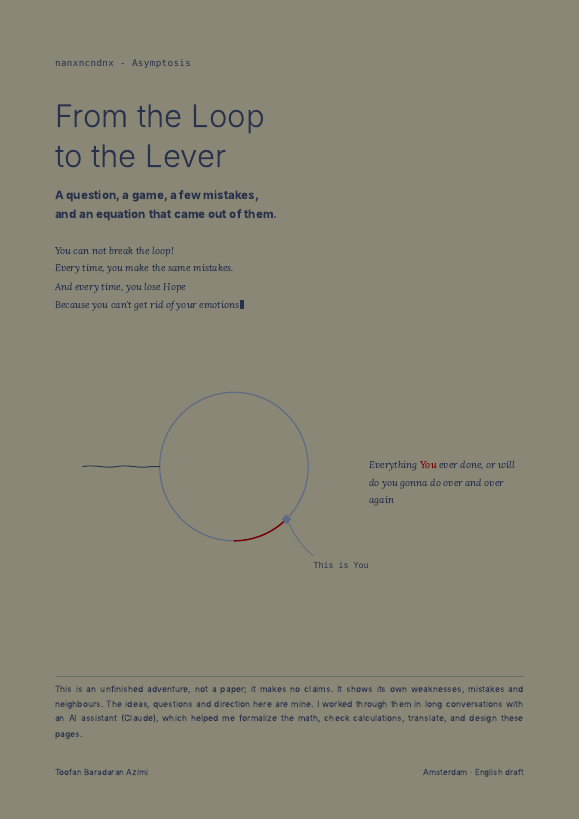

# From the Loop to the Lever

*A question, a game, a few mistakes, and an equation that came out of them.*

**[Read the full PDF (15 pages)](From_the_Loop_to_the_Lever.pdf)**

---

This is an unfinished adventure, not a paper. It makes no claims. It shows its own weaknesses, mistakes and neighbours.

The ideas, questions and direction here are mine. I worked through them in long conversations with an AI assistant (Claude), which helped me formalize the math, check calculations, translate, and design these pages.

## What it is

It starts with a question about acceptance: the brain accepts non-existence only up to a point, and always keeps a measurable space for hope. Between two boundaries, a "judge's lever" moves; near either boundary, the brain asks a simple, unanswerable question whose answer lies on the other side, and everything inverts.

A week later, the same picture was rebuilt as a small mathematical model. The container and the walls turned out not to be separate things: the lever is a weighted average of the kinds of answers you have given, and its two ends are horizons, not walls.

## The path

| Date | Step |
|---|---|
| 4 Nov 2026 | **Boundaries of Acceptance**: the question reached paper |
| 11 Nov 2026 | **First version of the lever**: the game began, with three kinds of answer |
| 12 Nov 2026 | **The Direction of the Lever's Motion**: rebuilt from the root; six axioms, eight theorems, four hypotheses kept apart |

## Honest notes

- **Zero measured numbers.** The model is structure only. Its main axioms are claims about the brain that have not been tested.
- **Not new where it isn't.** The equation of motion, `p_n = (1 − k) p_(n−1) + k A`, belongs to the same family as Hogarth and Einhorn's (1992) belief-adjustment model and linear-operator learning models. What may be new is deriving it from explicit axioms, classifying answers by measurability, and the "two ledgers."
- **The loop is still open.** Inversion is made exact; where the turning around comes from is still a hypothesis.

Every claim in the PDF carries a label (axiom, definition, theorem, proof, hypothesis) so the weak spots are easy to find. Criticism is welcome; please open an issue.

## Status

Unfinished, on purpose. The adventure is long, and full of stories that are one of a kind.

## License

Text and figures: [CC BY 4.0](https://creativecommons.org/licenses/by/4.0/). You may share and adapt with attribution.

© 2026 Toofan Baradaran Azimi · Amsterdam
